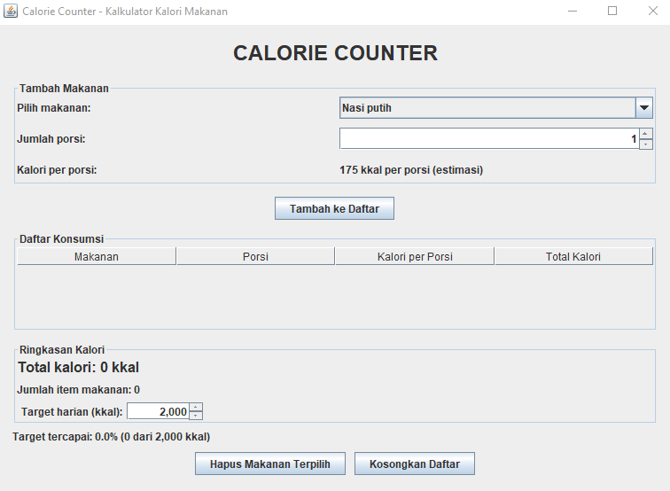
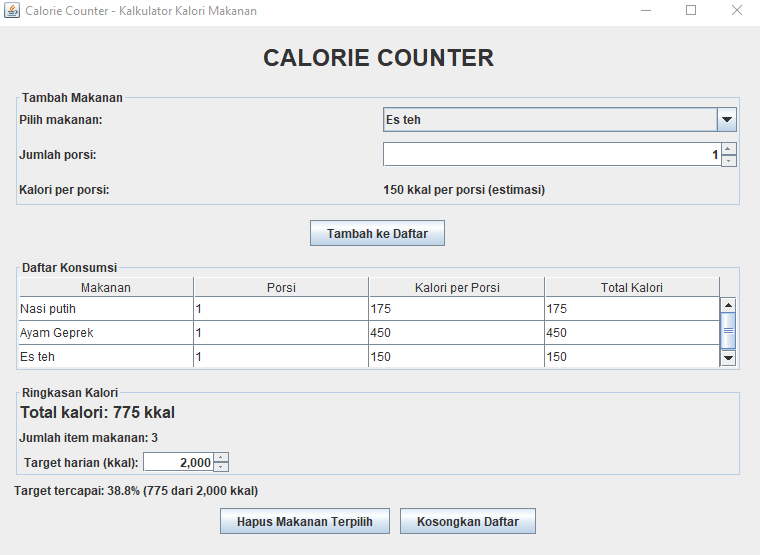

# Kalkulator Kalori Makanan

## Nama: Nadine Desvita Alifia Putri
## NIM: F1D02410129

---

## 1. Deskripsi Aplikasi

Kalkulator Kalori Makanan adalah aplikasi desktop berbasis Java Swing yang digunakan untuk membantu pengguna memperkirakan jumlah kalori dari makanan dan minuman yang dikonsumsi.

Pengguna dapat memilih makanan atau minuman dari daftar yang tersedia, menentukan jumlah porsi, kemudian menambahkannya ke tabel konsumsi. Aplikasi akan menampilkan total kalori, jumlah jenis makanan yang dicatat, serta persentase pencapaian target kalori harian.

Aplikasi ini juga menyediakan fitur untuk menghapus makanan yang dipilih dan mengosongkan seluruh daftar konsumsi.

Rumus perhitungan kalori:

`Total Kalori = Kalori per Porsi × Jumlah Porsi`

Persentase pencapaian target kalori harian dihitung menggunakan rumus:

`Persentase Target = (Total Kalori / Target Kalori Harian) × 100%`

Nilai kalori yang digunakan merupakan estimasi. Kalori sebenarnya dapat berbeda tergantung ukuran porsi, bahan, dan cara pengolahan makanan.

## 2. Fitur Aplikasi

- Memilih makanan dan minuman dari daftar yang tersedia.
- Menentukan jumlah porsi menggunakan spinner.
- Menampilkan estimasi kalori per porsi.
- Menghitung total kalori berdasarkan jumlah porsi.
- Menambahkan makanan dan minuman ke tabel konsumsi.
- Menampilkan nama makanan, jumlah porsi, kalori per porsi, dan total kalori.
- Menampilkan total kalori dari seluruh makanan yang dicatat.
- Menampilkan jumlah jenis makanan yang dicatat.
- Mengatur target kalori harian.
- Menampilkan persentase pencapaian target kalori harian.
- Menghapus makanan yang dipilih dari tabel.
- Menghapus seluruh daftar konsumsi.
- Memperbarui ringkasan kalori setelah data ditambahkan atau dihapus.
- Menampilkan pesan peringatan jika pengguna mencoba menghapus makanan tanpa memilih baris pada tabel.

## 3. Teknologi

- Bahasa pemrograman: Java
- Library GUI: Java Swing
- Library pendukung: Java AWT
- Komponen tabel: `JTable` dan `DefaultTableModel`
- IDE: Visual Studio Code
- JDK: Java Development Kit

## 4. Komponen GUI

### Top-Level Container

- `JFrame`: digunakan sebagai jendela utama aplikasi Kalkulator Kalori Makanan.
- `getContentPane()` dan `setContentPane()`: digunakan untuk mengakses dan mengatur wadah utama komponen GUI.
- `JOptionPane`: digunakan untuk menampilkan pesan peringatan dan konfirmasi kepada pengguna.

### Intermediate Components

- `JPanel`: mengelompokkan komponen GUI berdasarkan bagian tampilan, seperti header, form input, tombol aksi, tabel konsumsi, dan ringkasan kalori.
- `JScrollPane`: menyediakan area yang dapat digulir untuk melihat data makanan pada tabel jika jumlah data melebihi area tampilan.

### Atomic Components

- `JLabel`: menampilkan judul aplikasi, label input, informasi kalori per porsi, total kalori, jumlah makanan, persentase target, dan status aplikasi.
- `JComboBox`: menyediakan pilihan makanan dan minuman.
- `JSpinner`: digunakan untuk menentukan jumlah porsi dan mengatur target kalori harian.
- `JButton`: digunakan untuk menjalankan tindakan tambah makanan, hapus pilihan, dan hapus semua.
- `JTable`: menampilkan daftar makanan dan informasi kalorinya.
- `DefaultTableModel`: mengelola data yang ditampilkan pada tabel, termasuk penambahan dan penghapusan baris.

## 5. Layout Manager

### BorderLayout

`BorderLayout` digunakan untuk membagi area jendela menjadi lima bagian, yaitu `NORTH`, `SOUTH`, `EAST`, `WEST`, dan `CENTER`.

Pada aplikasi ini, `BorderLayout` digunakan untuk mengatur posisi header, form input, tabel konsumsi, dan panel ringkasan kalori.

### GridLayout

`GridLayout` digunakan untuk menyusun komponen dalam bentuk baris dan kolom dengan ukuran sel yang sama.

Pada aplikasi ini, `GridLayout` digunakan untuk menyusun judul dan subjudul, form input makanan, serta informasi ringkasan kalori.

### FlowLayout

`FlowLayout` digunakan untuk menyusun komponen secara berurutan dalam satu baris.

Pada aplikasi ini, `FlowLayout` digunakan untuk menyusun tombol Tambah Makanan, Hapus Pilihan, dan Hapus Semua secara horizontal.

## 6. Event Handling

Aplikasi ini menerapkan *Delegation Event Model* untuk menangani interaksi pengguna dengan komponen GUI.

Terdapat dua interface yang diimplementasikan langsung oleh class `KalkulatorKaloriMakanan`, yaitu `ActionListener` dan `ItemListener`. Selain itu, aplikasi menggunakan `ChangeListener` untuk menangani perubahan nilai pada komponen spinner.

### ActionListener

`ActionListener` digunakan untuk menangani aksi ketika pengguna menekan tombol.

- `actionPerformed(ActionEvent e)`: menangani aksi yang dilakukan pengguna.
- `e.getActionCommand()`: digunakan untuk mengetahui perintah dari tombol yang ditekan.
- Tombol Tambah Makanan menambahkan makanan yang dipilih ke tabel konsumsi.
- Tombol Hapus Pilihan menghapus baris makanan yang dipilih.
- Tombol Hapus Semua menghapus seluruh daftar konsumsi setelah pengguna memberikan konfirmasi.

### ItemListener

`ItemListener` digunakan untuk menangani perubahan pilihan pada komponen `JComboBox`.

- `itemStateChanged(ItemEvent e)`: menangani perubahan status pilihan.
- `ItemEvent.SELECTED`: menunjukkan bahwa suatu pilihan telah dipilih.
- Ketika pengguna memilih makanan atau minuman yang berbeda, informasi kalori per porsi diperbarui sesuai dengan pilihan tersebut.

### ChangeListener

`ChangeListener` digunakan untuk menangani perubahan nilai pada komponen spinner.

- `stateChanged(ChangeEvent e)`: menangani perubahan nilai komponen.
- Perubahan jumlah porsi dapat digunakan untuk memperbarui informasi terkait jumlah porsi yang dipilih.
- Perubahan target kalori harian memicu pembaruan ringkasan dan persentase pencapaian target kalori.

## 7. Cara Menjalankan

Pastikan Java Development Kit (JDK) sudah terpasang dan terminal berada di folder tempat file `KalkulatorKaloriMakanan.java` disimpan.

Kompilasi program:

```bash
javac KalkulatorKaloriMakanan.java
```

Jalankan program:

```bash
java KalkulatorKaloriMakanan
```

Program juga dapat dijalankan menggunakan perintah:

```bash
java -cp . KalkulatorKaloriMakanan
```

Pastikan nama file sama dengan nama class utama yang digunakan dalam program.

## 8. Struktur Proyek

```text
KalkulatorKaloriMakanan/
├── KalkulatorKaloriMakanan.java
├── README.md
└── screenshot/
    ├── awal.png
    ├── tambah_makanan-hasil_kalori.png
```

Keterangan:

- `KalkulatorKaloriMakanan.java`: berisi kode sumber aplikasi.
- `README.md`: berisi deskripsi aplikasi, fitur, komponen GUI, layout manager, event handling, dan cara menjalankan program.
- `screenshot/awal.png`: dokumentasi tampilan awal aplikasi.
- `screenshot/tambah_makanan-hasil_kalori.png`: dokumentasi tampilan aplikasi setelah makanan ditambahkan serta dokumentasi hasil perhitungan total kalori dan pencapaian target harian.


## 9. Penyimpanan Data

Data makanan yang ditambahkan ke tabel disimpan sementara di memori selama aplikasi berjalan. Data tersebut dikelola menggunakan `DefaultTableModel` dan ditampilkan melalui komponen `JTable`.

Total kalori, jumlah jenis makanan, dan persentase pencapaian target kalori dihitung berdasarkan data konsumsi yang tercatat pada tabel.

Daftar makanan dan estimasi kalorinya disimpan dalam kode program, sedangkan jumlah porsi dan target kalori harian dapat diatur melalui komponen spinner.

Aplikasi ini tidak menggunakan database atau penyimpanan file permanen. Oleh karena itu, data konsumsi akan hilang ketika aplikasi ditutup.

## 10. Dokumentasi Screenshot

### Tampilan Awal

Menampilkan tampilan awal aplikasi sebelum pengguna menambahkan makanan, termasuk pilihan makanan, jumlah porsi, target kalori harian, tabel konsumsi, dan ringkasan kalori.



### Penambahan Makanan & Hasil Perhitungan Kalori

Menampilkan daftar makanan yang telah ditambahkan ke tabel beserta jumlah porsi dan estimasi kalorinya, serta menampilkan total kalori konsumsi, jumlah jenis makanan yang dicatat, dan persentase pencapaian target kalori harian.


